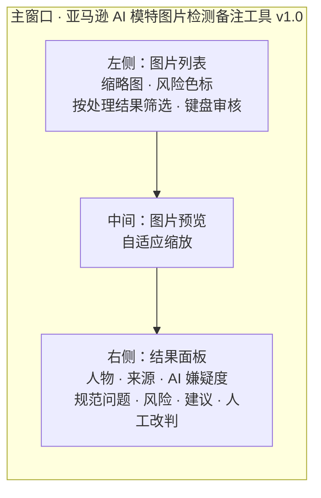
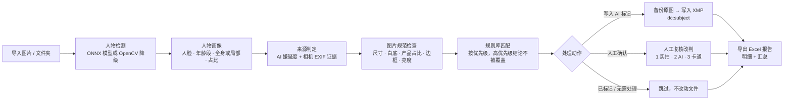
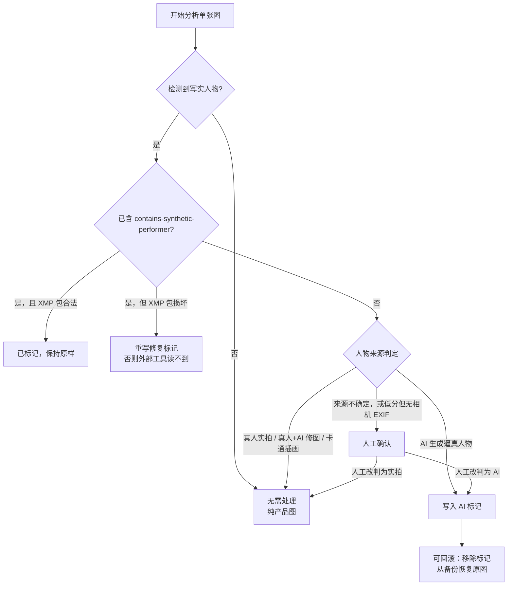
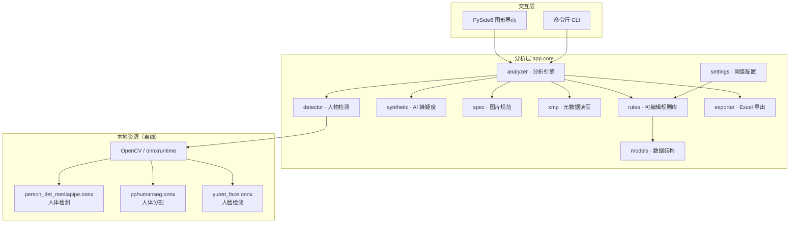

# 亚马逊 AI 模特图片检测备注工具 · Amazon AI Model Image QA

> 上传前，把「这批图里有没有 AI 生成的逼真人物、要不要写 `contains-synthetic-performer`」一次性查清楚。


一个**完全本地运行**的 Windows 桌面工具：批量检测商品图里是否出现写实人物 / 模特，判断人物是否可能由 AI 生成，按亚马逊要求写入 XMP 标记，并导出可交付给团队复核的 Excel 报告。

它不上传任何图片、不调用任何在线 API，也不需要安装 Python、exiftool 或 Adobe 套件。

---

## 📌 一句话说明

亚马逊要求：主图 / 商品图中若出现**由 AI 生成的逼真人物（synthetic performer）**，必须在图片的 XMP `dc:subject` 字段写入关键词 `contains-synthetic-performer`。这个工具把「找出这类图 → 判断该不该标 → 正确写入标记 → 留痕出报告」串成一条可批量执行的流水线。

> 亚马逊官方公告原文（工具内引用）：
> *"you must use an IPTC-compatible metadata editor to add the keyword 'contains-synthetic-performer' to the dc:subject (XMP) field"*

工具写入的标记与命令 `exiftool -XMP-dc:Subject+="contains-synthetic-performer" -overwrite_original x.jpg` 等价，但**额外支持 PNG / WEBP**，且不依赖任何外部程序。

---

## 🎯 适用什么客户

| 客户 / 角色 | 典型痛点 | 这个工具给到什么 |
|---|---|---|
| **亚马逊卖家 / 店铺运营** | 一批几百张主图里混了 AI 模特图，不知道哪些要标、漏标怕被下架，全标又怕误伤实拍图 | 批量扫描后按「需写入 / 人工确认 / 已标记 / 无需处理」分流，一键只处理该处理的那几张 |
| **电商美工 / 视觉团队** | 设计师用 Midjourney / SD / 即梦出模特图，导出后元数据被洗掉，自己也记不清哪张是 AI | 给出 AI 嫌疑度、判定依据和相机 EXIF 证据，配合人工一键改判，不用靠记忆 |
| **AI 生图工作室 / 素材服务商** | 交付给卖家的图需要合规标注，客户要求提供标注凭证 | 「全部标为 AI 并写入」批量声明模式 + Excel 报告，可作为交付附件 |
| **跨境合规 / 品控 / 审核岗** | 需要可复核、可追溯的结论，而不是一个黑盒分数 | 每条结论都带规则名、风险说明、处理建议；规则库可编辑，改阈值不用重新打包 |
| **摄影 / 后期外包验收** | 外包混用了 AI 修图与真人实拍，验收时难以区分 | 明确区分「真人 + AI 修图（无需标记）」与「AI 生成人物（必须标记）」 |
| **多店铺 / 代运营公司** | 同一套图要发给多个客户，重复检查成本高 | 本地离线、无账号无额度，装一次无限次用，配置文件按用户目录隔离 |

**不适用**：需要 100% 司法级鉴定「这张图是不是 AI 生成」的场景。本地离线无法给出这种结论，详见 [能力边界](#️-能力边界诚实说明)。

---

## 🖼 界面长什么样

主窗口是「左列表 / 中预览 / 右结果」三栏，工具栏把高频动作做成了按钮和快捷键：



| 工具栏按钮 | 作用 |
|---|---|
| 添加图片 / 导入文件夹 | 递归收集 JPG / PNG / WEBP / TIFF，自动跳过备份目录和隐藏目录 |
| **开始分析** | 后台线程批量分析，进度条实时更新，界面不卡死 |
| 下一张待确认 | 跳到下一张「需人工确认」的图（快捷键 `N`） |
| 标为实拍 / 标为 AI | 人工改判（快捷键 `1` / `2`，`3` 为卡通插画） |
| 全部标为 AI 并写入 | **一键声明模式**：整批当作 AI 图直接写标记，不做检测 |
| 一键写入 Amazon AI 标记 | 只处理判定为「需写入标记」的图片 |
| 导出 Excel 报告 | 明细表 + 汇总表，带颜色标记和筛选 |
| 规则库 / 设置 | 直接编辑 `rules.json` 与阈值 |
| 写入前备份原图 | 默认勾选，原图副本放到同级 `_amzqa_backup/` |

---

## 🔄 工作流程图解



---

## 🧠 判定逻辑图解

工具最终只会给出四种动作之一：`无需处理`、`写入 AI 标记`、`人工确认`、`已标记`。



> ⚠️ 核心原则：**「没找到 AI 证据」≠「有证据表明是真人」**。
> AI 图经 PS / Lightroom 重新导出后，元数据被抹掉、统计特征被「洗白」，嫌疑度会掉到 0.00；此时工具不会直接判为实拍，而是再查有没有**真实拍摄设备的正面证据（相机 EXIF）**，没有就转人工确认。

---

## 🏗 模块架构图解



---

## ❓ 为什么这样做

这里列结论，完整技术论证见 [`docs/DESIGN.md`](docs/DESIGN.md)。

| # | 设计决策 | 原因 |
|---|---|---|
| 1 | **写入 XMP `dc:subject` 关键词** | 亚马逊公告明确要求用 IPTC 兼容的元数据编辑器把 `contains-synthetic-performer` 写进该字段；只改文件名或拼一个 JSON 侧车文件都不算合规 |
| 2 | **「有关键词」和「XMP 包合法」分开判断** | 早期做法把 `Iptc4xmpExt:DigitalSourceType` 拼进了 `<rdf:Description>` 开始标签内部，产出非法 XML。宽松正则能读出关键词，但 Adobe XMP Toolkit / Windows 属性处理器会**整包拒绝** → 出现「文件里明明有标记，资源管理器却显示没有」的坏包 |
| 3 | **纯 Python 读写 XMP，不依赖 exiftool** | 交付给不懂命令行的运营同事也能双击运行；同时原生支持 PNG / WEBP，不用给每台机器配环境 |
| 4 | **按文件内容魔数判断格式，不只看扩展名** | AI 工具导出、批量改名、CDN 转码都可能让 `.jpg` 实际是 PNG；按扩展名解析会直接写入失败 |
| 5 | **本地只算「AI 嫌疑度」，不给绝对结论** | 本地离线无法 100% 判定生成来源。工具综合元数据线索、相机 EXIF、频谱特征、噪声与平滑度给出 0~1 参考值，并明确标注这是启发式 |
| 6 | **低分之后还要查相机 EXIF** | 防止「被洗白的 AI 图」被高置信度误判为实拍；没有正面实拍证据就转人工 |
| 7 | **ONNX 模型 + OpenCV 内置检测器降级** | 模型文件缺失或无 onnxruntime 时仍能跑（精度下降但可用），不至于整批卡死 |
| 8 | **中文路径先把模型拷到临时 ASCII 目录** | OpenCV 的 `cv::dnn` 在 Windows 用窄字符打开文件，路径含中文会加载失败；工具目录名常常就是中文 |
| 9 | **递归收集时跳过 `_amzqa_backup/` 和隐藏目录** | 否则备份副本会被当成待检图片重复计入，出现「同一张图两条记录，一条已标记一条待写入」的假象 |
| 10 | **白底检查用「边框带近白像素占比」** | 主图要求产品占画面 85% 以上，产品会逼近边缘侵入采样带；用「平均亮度 + 方差」会被产品拉低而误判成非白底 |
| 11 | **规则库外置为 `rules.json`，按优先级匹配** | 合规口径会变，改规则不该重新打包 exe；且同一字段只采用最高优先级结论，避免「已标记」被低优先级规则改回「需写入」 |
| 12 | **写入前自动备份 + 后台线程执行** | 写标记会直接改动原图；100 张图同步跑备份会把界面冻住十几秒，所以放到工作线程 |
| 13 | **审核用 `1` / `2` / `3` / `N` 快捷键** | 要快速过几十张「需人工确认」的图，鼠标点下拉框太慢 |
| 14 | **规范检查只做确定性项目** | 尺寸、白底、占比、边框、亮度、格式都有明确标准；「好不好看」这类主观判断不交给算法，避免误判 |

---

## ✅ 方便什么

- **一次导入整个文件夹**：递归收集，自动跳过备份目录与隐藏目录，不用手工挑图
- **不用装任何东西**：exe + `_internal` 目录拷过去就能跑，无 Python / exiftool / 联网 / 账号 / API Key
- **不碰不该碰的图**：一键写入只处理「需写入标记」的图片，真人实拍、卡通插画、纯产品图原样不动
- **可反悔**：写入前自动备份到 `_amzqa_backup/`，支持移除当前图标记，规则判定结果可人工覆盖并留备注
- **可交付**：Excel 报告带明细、汇总、条件配色、冻结表头和筛选，直接发给运营或客户复核
- **可改口径**：`rules.json` / `settings.json` 放在用户目录，exe 打包之后依然能改阈值、加规则
- **双模式**：图形界面给运营，命令行给批量脚本；`--json` 可对接自动化
- **明确告诉你「不确定」**：拿不准的图不会硬给结论，而是标成人工确认并写明原因

---

## 📊 Excel 报告字段

**明细表**（每行一张图）：

| 字段组 | 列 |
|---|---|
| 基本信息 | 图片、人物、数量、类型、来源、性别、年龄段、展示（全身 / 局部）、占比 |
| 图片规范 | 尺寸（长边 px）、白底、产品占比、边框、规范问题 |
| AI 判定 | AI 嫌疑度、AI 判定依据、相机 EXIF |
| 结论 | 风险、处理动作、是否已带亚马逊标记、标记包状态、人工备注、说明、建议、原图路径 |

**汇总表**：图片总数、含人物数、AI 生成人物数、无相机 EXIF 数、需写入标记数、需人工确认数、已写入标记数、导出时间。

风险与动作会用底色区分（红 / 黄 / 蓝 / 绿），表头冻结并开启自动筛选，几百张图也能快速定位。

---

## 🚀 使用方式

### 方式一：直接运行（推荐）

1. 下载本仓库（页面右上角 **Code → Download ZIP**）并解压，或 `git clone` 本仓库
2. 保持 `亚马逊AI模特图片检测工具.exe` 与 `_internal` 目录**在同一层**（这是 PyInstaller onedir 分发，删掉 `_internal` 程序无法启动）
3. 双击 exe → 导入图片或文件夹 → 开始分析 → 处理结论 → 导出 Excel

> 首次启动会在用户目录生成 `AmzModelQA/rules.json`（默认规则）与 `AmzModelQA/settings.json`（阈值）。
> 支持 JPG / PNG / WEBP / TIFF。写入标记会修改原图，默认先备份到图片同级的 `_amzqa_backup/`。

### 方式二：命令行（适合批量脚本）

把 `main.py` 换成 exe 路径即可，参数一致：

```bash
# 图形界面
亚马逊AI模特图片检测工具.exe

# 分析单张图或整个目录，导出 Excel
亚马逊AI模特图片检测工具.exe --cli "D:\商品图" --excel "审核报告.xlsx"

# 分析并直接写入标记
亚马逊AI模特图片检测工具.exe --cli "D:\商品图" --write-tag

# 输出 JSON，便于对接自动化
亚马逊AI模特图片检测工具.exe --cli "D:\商品图" --json

# 一键标注：整批人工声明为 AI 生成，不做检测
亚马逊AI模特图片检测工具.exe --cli "D:\商品图" --force-tag
```

`--force-tag` 适合**你本来就明确知道这批图全是 AI 生成**的情况：不用先跑检测，也不用先「标为 AI」再「一键写入」。这条路径上工具不做任何检测判断，属于使用者的人工声明。

---

## ⚙️ 可调配置

| 文件 | 位置 | 作用 |
|---|---|---|
| `rules.json` | `<用户目录>/AmzModelQA/rules.json` | 规则库：条件字段、`eq` / `in` / `gte` / `contains` 等操作符、优先级、结论动作、风险与建议文案。首次启动自动生成，改坏会自动备份为 `rules.v1.bak.json` |
| `settings.json` | `<用户目录>/AmzModelQA/settings.json` | 阈值等可调参数，打包后仍可修改 |

内置默认规则覆盖：AI 生成人物需写入标记、AI 人物且已标记、AI 儿童人物额外核查、分数低但无相机 EXIF、来源不确定、真人实拍、卡通人物、无人物、人物占比过大、局部 / 手模保守提示。

---

## ⚠️ 能力边界（诚实说明）

- **不能 100% 判定 AI 生成**。本地离线的四类信号（元数据、相机 EXIF、频谱、噪声平滑度）只能给出嫌疑度参考值。经过重新导出 / 压缩 / 修图的 AI 图可能低分。
- **低分不等于实拍**。工具会额外检查相机 EXIF 作为正面证据，缺证据时转人工确认。
- **规范检查只覆盖可量化项**。美观度、构图、品牌合规等主观判断仍需人工。
- **规则是通用默认口径**。亚马逊政策会更新，上线前请以卖家后台最新公告为准，必要时自行调整 `rules.json`。
- **写入标记会改动原图**。请保留「写入前备份原图」勾选，并在批量写入前先用小批量验证。
- **仓库内不含 Python 源码**，提供的是可直接运行的 Windows 构建产物与完整说明文档。

---

## 📁 目录结构

```
amazon-ai-image-qa/
├── README.md                       ← 本页（标准详情页）
├── LICENSE                         ← MIT
├── THIRD_PARTY_NOTICES.md          ← 第三方组件与许可
├── docs/
│   └── DESIGN.md                   ← 设计决策详解：为什么这样做
└── 亚马逊AI模特图片检测工具/        ← 可直接运行的完整程序
    ├── 亚马逊AI模特图片检测工具.exe    （约 5.5 MB）
    └── _internal/                     （约 325 MB，308 个文件，必须保留）
        ├── models/                    person_det_mediapipe / pphumanseg / yunet_face .onnx
        ├── cv2/  PySide6/  onnxruntime/  numpy.libs/  PIL/
        └── ...
```

> 体积说明：`_internal` 是 PySide6 / OpenCV / ONNX Runtime 等本地运行时，所以仓库较大（约 325 MB），换来的是**解压即用、完全离线**。单个文件最大约 75 MB，未超过 GitHub 单文件 100 MB 限制。

---

## ❓ FAQ

**Q：为什么双击 exe 没反应？**
A：确认 `_internal` 目录与 exe 在同一层且完整；从 ZIP 解压时不要只拖出 exe。

**Q：会上传我的商品图吗？**
A：不会。程序完全本地运行，无网络请求、无账号、无遥测。

**Q：能不能只给几张图写标记？**
A：可以。用筛选框挑出「需写入标记」，或在列表里多选后处理；「一键写入」只作用于判定为需写入的图片。

**Q：标错了怎么办？**
A：选中图片用「移除当前标记」回滚，或从 `_amzqa_backup/` 取回原图；人工改判会写入备注，报告里可追溯。

**Q：为什么提示「已带标记」但资源管理器 / Adobe 里看不到？**
A：这是 XMP **坏包**：文件里写了关键词，但 XML 不合法，严格解析器整包拒绝。工具会标成 `损坏（外部工具读不到，需修复）`，用一键写入重写即可修复。

**Q：三个 ONNX 模型各干什么？**
A：`person_det_mediapipe` 检测人体框，`pphumanseg` 做人体分割以精确计算人物占比，`yunet_face` 检测人脸以辅助人物画像。缺失时自动降级到 OpenCV 内置检测器。

**Q：可以用在别的平台（Shopify / 独立站）吗？**
A：图片规范检查与 AI 人物检测是通用的；`contains-synthetic-performer` 标记是亚马逊口径，其他平台请按其规则调整 `rules.json`。

---

## 🔒 第三方组件与许可

本仓库再分发的二进制包含 PySide6 / Qt、OpenCV、ONNX Runtime、NumPy、Pillow、openpyxl 及三个公开 ONNX 模型，各自权利归原作者并遵循其原始许可，详见 [`THIRD_PARTY_NOTICES.md`](THIRD_PARTY_NOTICES.md)。本项目自身的文档与脚本采用 MIT 许可。

---

## 📄 License

[MIT](LICENSE) © 2026 mcneel

> 工具仅作为辅助检查手段，最终合规判断请以亚马逊卖家平台最新政策与人工复核为准。
