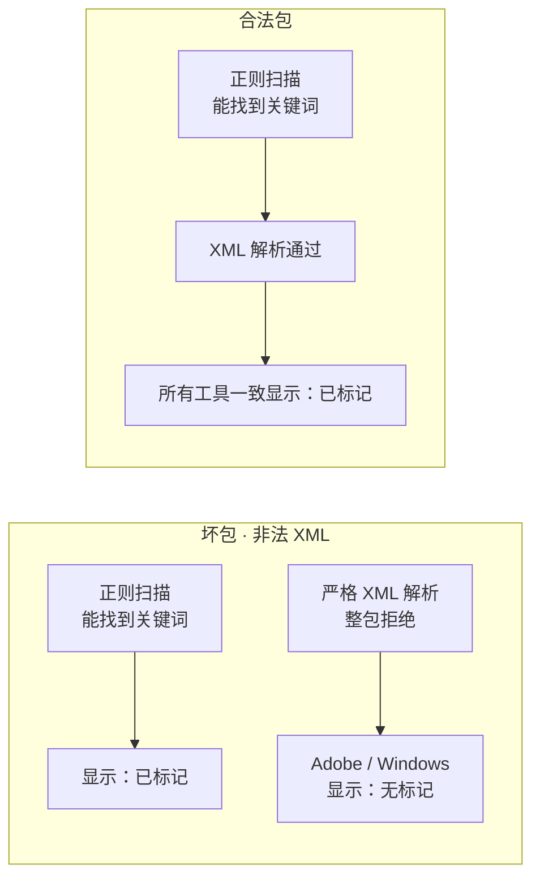
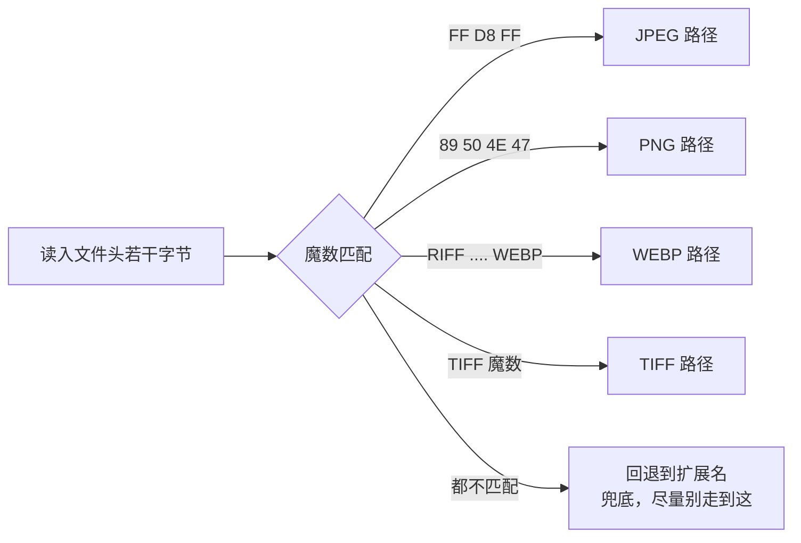
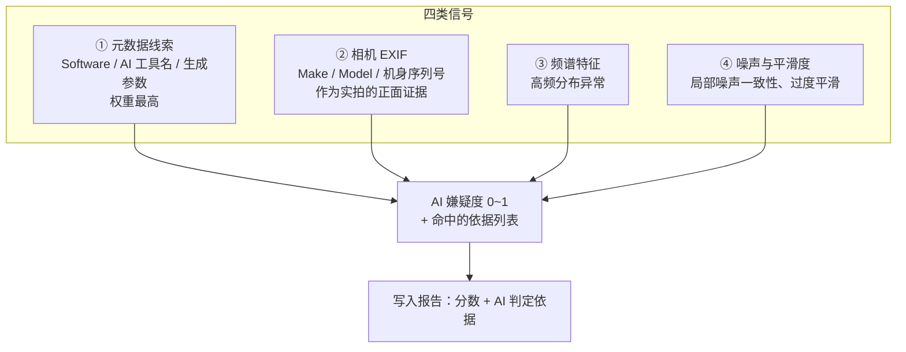
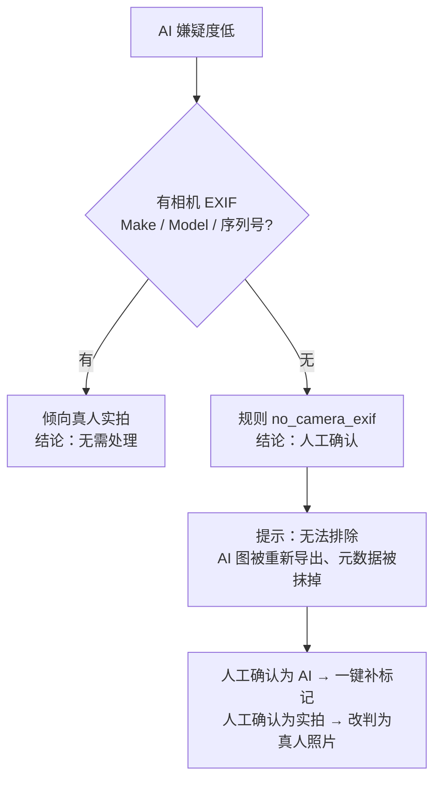
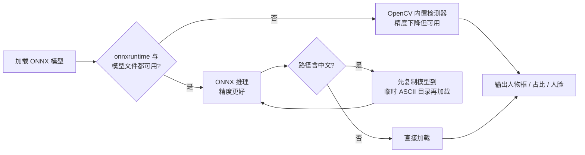
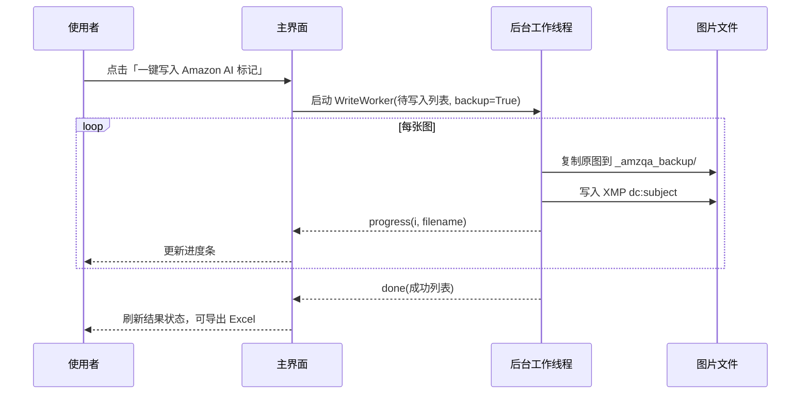

# 设计说明：为什么这样做

> 本文是对 [`README.md`](../README.md) 中「为什么这样做」的展开，逐条解释设计决策、踩过的坑，以及这些决策给使用者带来的实际好处。
> 文中代码均为**逻辑示意**，仓库分发的是打包好的 Windows 程序，不含 Python 源码。

---

## 1. 合规起点：标记必须写进 XMP，而不是别的地方

亚马逊公告要求使用 IPTC 兼容的元数据编辑器，把关键词 `contains-synthetic-performer` 加入 `dc:subject` (XMP) 字段。对标命令：

```bash
exiftool -XMP-dc:Subject+="contains-synthetic-performer" -overwrite_original x.jpg
```

**为什么不做成「改文件名 / 写同名 txt / 维护一张 Excel 清单」？**
因为平台读取的是图片**内嵌元数据**。文件名和侧车文件在上传、转码、CDN 分发过程中都会丢失；只有写进文件本身的 XMP 包才会跟着图片走。

工具用纯 Python 实现了等价写入，并额外覆盖 PNG / WEBP：

| 格式 | XMP 载体 | 工具做法 |
|---|---|---|
| JPEG | APP1 段（`http://ns.adobe.com/xap/1.0/`） | 定位 / 插入 APP1 段，保留原有段 |
| PNG | `iTXt` 文本块（关键字 `XML:com.adobe.xmp`） | 读写 iTXt 块并校验 CRC |
| WEBP | RIFF `XMP ` 块 | 在 RIFF 结构中插入 / 替换块 |
| TIFF | 作为兜底识别 | 按内容魔数识别，避免误判 |

写入时会合并已有的 `dc:subject` 列表（不是覆盖），并补充 IPTC 的 `DigitalSourceType`（`trainedAlgorithmicMedia` / `compositeWithTrainedAlgorithmicMedia`），让 Adobe 系列工具也能识别数字来源类型。

---

## 2. 「有关键词」和「XMP 包合法」必须分开判断

这是整个工具最关键的一个坑。

早期实现把 `Iptc4xmpExt:DigitalSourceType` 元素拼进了 `<rdf:Description ...>` 的**开始标签内部**（即 `>` 之前），产出的是**非法 XML**：



工具因此把状态拆成两个布尔值：

| `has_amazon_tag` | `tag_packet_ok` | 判定 | 处理 |
|:---:|:---:|---|---|
| `True` | `True` | 已正确标注，外部工具读得到 | 无需再动 |
| `True` | `False` | **坏包**：写了但读不到 | 重写修复，否则等于没标 |
| `False` | 任意 | 还没标注 | 按人物来源决定是否写入 |

报告里会把 `True / False` 显示成「**损坏（外部工具读不到，需修复）**」，而不是笼统的「已标记」——否则一批图会被错误地跳过。

> 校验方式：去掉 `<?xpacket ...?>` 处理指令后，用 XML 解析器 `fromstring` 严格解析整包。

---

## 3. 按文件内容魔数判断格式，而不是看扩展名

`.jpg` 实际是 PNG 的情况比想象中常见：AI 工具导出、批量改名脚本、某些 CDN 转码、设计同事从剪贴板另存。若按扩展名选解析器，会按错格式解析，写入直接失败，甚至破坏文件。



**好处**：批量处理混合来源的图片时，不会因为几张「名不副实」的图中断整批任务。

---

## 4. AI 判定只给「嫌疑度」，并诚实地标注边界

本地离线没有生成平台的元数据签名、没有模型指纹，**无法 100% 判定一张图是否 AI 生成**。工具综合四类可计算信号给出 0~1 的参考值：



**为什么不做成「AI / 非 AI」二分类打标？**
因为误判代价不对称：把实拍标成 AI 要重走合规流程，把 AI 标成实拍可能触发平台问题。给出分数 + 依据 + 「不确定」出口，让人工在关键节点做决定，比伪装成高置信度结论更负责任。

---

## 5. 低分之后必须再问一句：有没有相机 EXIF？

> ⚠️ 核心原则：**「没找到 AI 证据」≠「有证据表明是真人」**。

AI 图经 PS / Lightroom 重新导出后，元数据被洗掉、统计特征也被「洗白」，嫌疑度会掉到 `0.00`。如果只看分数，会得出「真人实拍」这种**高置信度的错误结论**。



这条规则（`no_camera_exif`）是默认规则库里专门为「被洗白的 AI 图」留的安全网。

---

## 6. 白底检查用「边框带近白像素占比」，不用「平均亮度 + 方差」

亚马逊主图要求产品占画面 **85% 以上**，这意味着产品会**逼近甚至侵入边缘采样带**。若对边框带算平均亮度和方差，产品像素会把均值拉低，纯白底反而被判成「非白底」。

```
┌───────────────────────────────────────┐
│░░░░░░░░░ 边框采样带 ░░░░░░░░░░░░░░│
│░  ┌─────────────────────────────┐  ░│
│░  │                             │  ░│
│░  │   产品主体（占比 85%+）      │  ░│
│░  │   可能贴边、侵入采样带  ←─────┼──┼── 若用「平均亮度」会被拉低
│░  │                             │  ░│
│░  └─────────────────────────────┘  ░│
│░░░░░░░░░░░░░░░░░░░░░░░░░░░░░░░░░│
└───────────────────────────────────────┘
   判据：采样带里「近白像素」的【占比】是否达标
        而不是采样带的【平均亮度 / 方差】
```

**为什么规范检查只做这些项**：尺寸（含亚马逊 500~10000px 硬性区间）、文件大小、白底、产品占比、边框、亮度、格式，都有明确标准、可复算、不会误判；「好不好看」这类主观判断不交给算法。

---

## 7. 模型降级与中文路径



**为什么要降级**：模型文件可能被清理软件删掉、被安全软件拦截，或用户只拷贝了部分目录。此时工具仍应能跑完一批图，而不是启动即崩。

**为什么要处理中文路径**：OpenCV 的 `cv::dnn` 在 Windows 上用窄字符打开文件，路径含中文会失败；而软件目录名（本仓库就是）经常是中文。先拷到临时 ASCII 路径是成本最低的兼容方案。

三个模型分工：

| 模型 | 体积 | 作用 |
|---|---:|---|
| `person_det_mediapipe.onnx` | ~12 MB | 人体检测框 |
| `pphumanseg.onnx` | ~6 MB | 人体分割，精确算人物占画面比例、反推人体框 |
| `yunet_face.onnx` | ~0.23 MB | 人脸检测，辅助人物画像（年龄段、是否写实） |

---

## 8. 递归收集时跳过备份目录和隐藏目录

写入标记前工具会把原图复制到图片同级的 `_amzqa_backup/`。如果下次「导入文件夹」时不排除它，备份副本会被当成待检图片，出现：

> 同一张图两条记录：一条「已标记」、一条「待写入」

这种假象会让人以为写入失败、反复重跑，甚至把备份图又写一遍。因此 `iter_images` 显式过滤 `_amzqa_backup` 与隐藏目录。

---

## 9. 规则库外置 + 按优先级匹配

规则放在 `<用户目录>/AmzModelQA/rules.json`，首次启动生成默认规则，支持 `eq` / `ne` / `in` / `not_in` / `gt` / `gte` / `lt` / `lte` / `contains` 等操作符。

**为什么外置**：合规口径会变（比如新增「儿童形象额外核查」「局部手模保守处理」）。改一个 JSON 就能生效，不需要重新打包 300 MB 的程序，也不需要用户升级版本。

**为什么按优先级**：考虑一张「AI 生成人物且已正确标注」的图，它同时命中「AI 生成 → 需写入标记」和「已标记 → 无需处理」。若后匹配的规则覆盖前面的结论，就会把已合规的图重新标成待处理。

```
规则按 priority 升序匹配
  → 同一字段只采用【最高优先级】命中规则的结果
  → 后续规则只补充风险条目 / 建议，不覆盖 action 结论
```

默认规则覆盖的场景：

| 规则 | 结论 |
|---|---|
| `ai_person_need_tag` | AI 生成逼真人物且未标记 → **写入 AI 标记** |
| `ai_person_already_tagged` | AI 人物且已标记 → **无需处理** |
| `ai_child_extra_check` | AI 儿童形象 → 额外核查提示（合规敏感度更高） |
| `no_camera_exif` | 分数低但无相机 EXIF → **人工确认** |
| `uncertain_source` | 人物来源判不准 → **人工确认** |
| `real_photo` | 真人实拍 / 真人 + AI 修图 → **无需标记** |
| `cartoon_person` | 卡通插画人物 → **无需标记** |
| `no_person` | 未检测到人物 → **无需处理** |
| `person_too_large` | 人物占比过高、弱化产品主体 → 构图提示 |
| `partial_body_hint` | 手模 / 局部身体 → 官方未明确，建议保守标注或人工判断 |

> 注意「真人 + AI 修图」与「AI 生成人物」的区别：**修图不改变人物本身**，不在标注范围内；生成人物才需要标记。这也是工具把 `person_source` 细分成 `ai_generated` / `real_photo` / `ai_edited_real` / `cartoon` / `unknown` 的原因。

---

## 10. 写入前备份 + 后台线程

写入 XMP 是**原地修改文件**。两个工程细节：

1. **备份**：默认把原图复制到同级 `_amzqa_backup/`，配合「移除当前标记」实现可回滚。
2. **线程**：100 张图同步复制 + 写入会把界面冻住十几秒。分析和写入都放在 `QThread` 工作线程，通过信号回传进度，主线程只更新进度条和列表。



---

## 11. 审核快捷键

要快速过几十张「需人工确认」的图，鼠标点下拉框是瓶颈。列表控件直接吃按键：

| 键 | 动作 |
|---|---|
| `1` | 标为真人实拍 → 无需处理 |
| `2` | 标为 AI 生成 → 需写入标记 |
| `3` | 标为卡通 / 插画 → 无需处理 |
| `N` | 跳到下一张待确认 |
| `Space` | 界面约定的辅助操作 |

人工改判会记录 `manual_override` 与 `manual_note`，在 Excel 报告里可追溯「谁把哪张图从什么结论改成了什么」。

---

## 12. 报告为什么要出 Excel，而不是只在界面里看

- 合规结论需要**交付和留痕**：发给运营、客户、外包方复核，或存档应对平台问询
- 界面适合「处理」，表格适合「核对」：可筛选、可排序、可按颜色扫一遍风险项
- 汇总表给出「图片总数 / 含人物 / AI 生成 / 无相机 EXIF / 需写入 / 需人工确认 / 已写入」几个关键数量，方便交差
- 明细表保留 `AI 判定依据` 与 `建议` 两列，让复核的人知道**为什么**得出这个结论，而不是只看到一个标签

---

## 小结

| 用户能感知到的 | 背后的设计 |
|---|---|
| 解压就能用，不装环境 | 纯 Python 写 XMP + 本地模型 + 运行时随包分发 |
| 不会误标实拍图 | 「有关键词 / 包合法」双判断 + 相机 EXIF 安全网 + 来源不确定转人工 |
| 标错了能改回来 | 写入前备份 + 移除标记 + 人工改判留痕 |
| 几百张图不卡 | 递归过滤备份目录 + 后台线程 + 键盘审核 |
| 口径变了不用升级 | 外置规则库 + 优先级匹配 + 可调阈值 |
| 结论能交付 | Excel 明细 + 汇总 + 判定依据 + 建议 |
